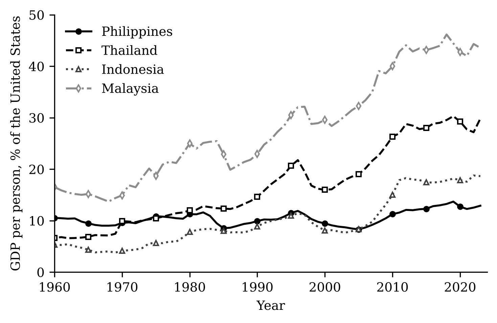
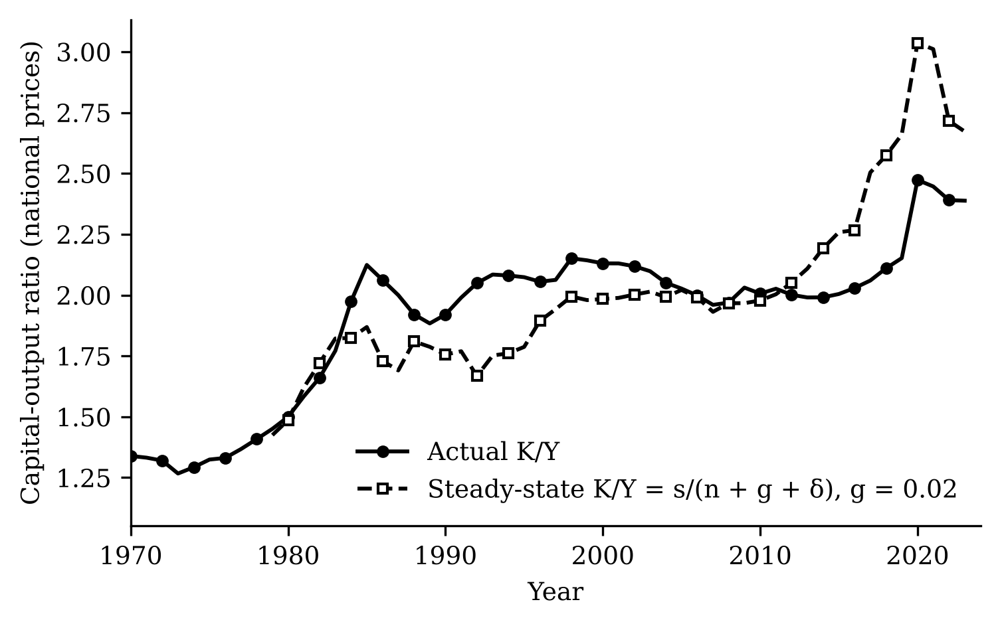
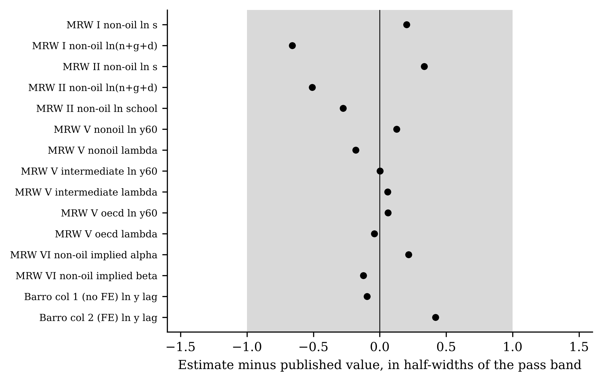
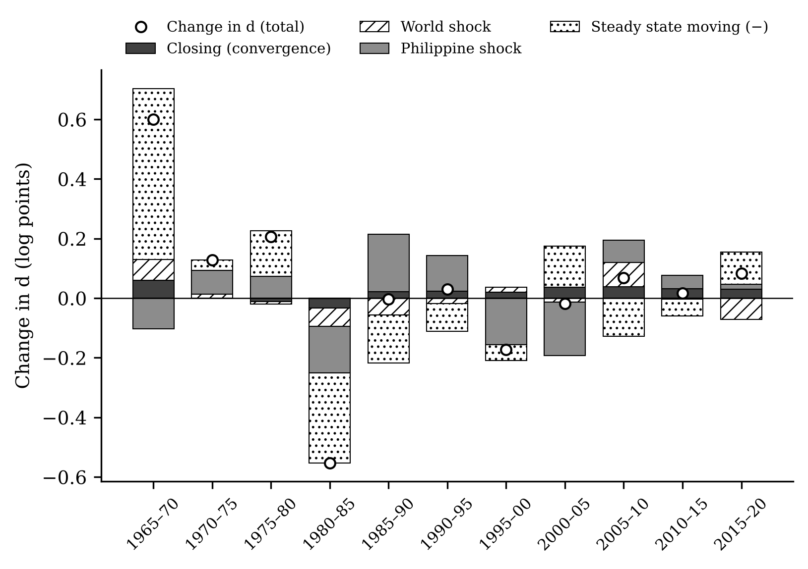
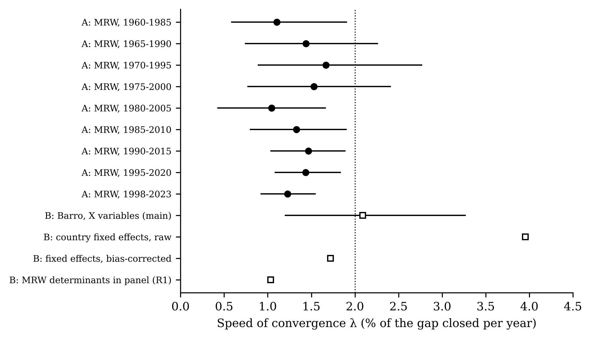
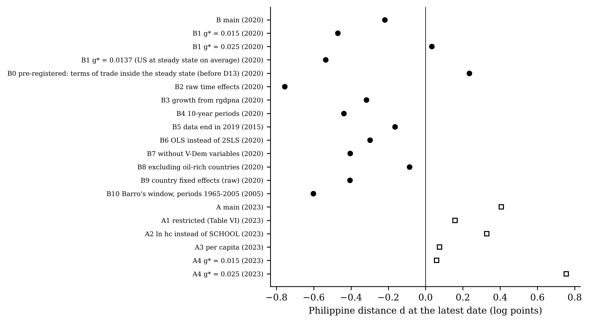
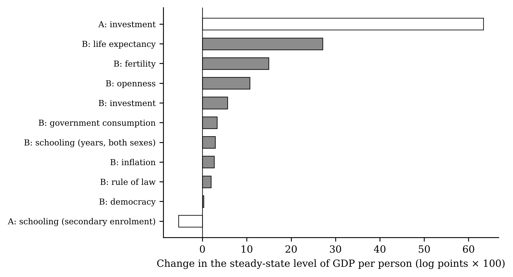
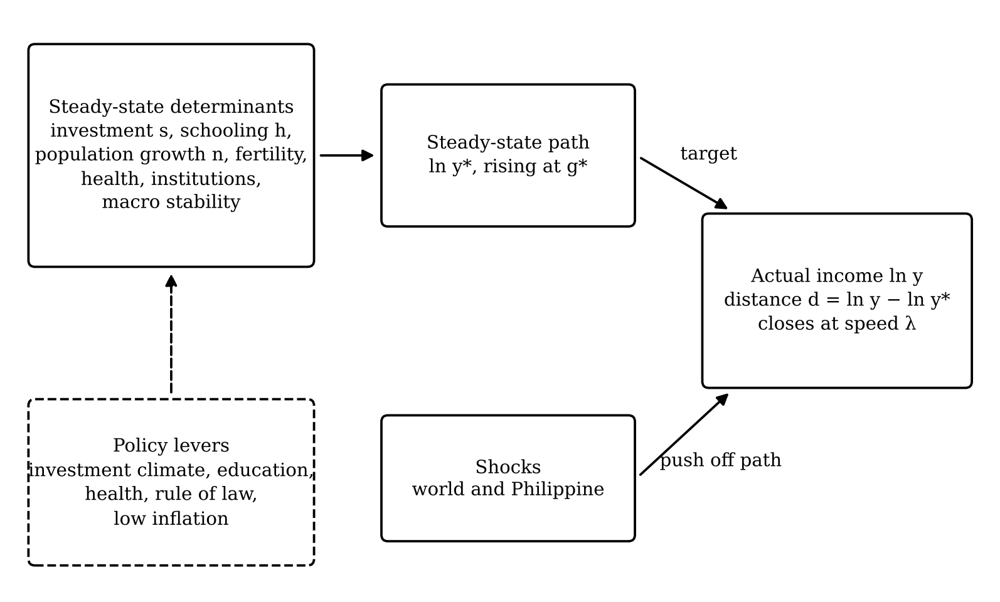

**Abstract.** For six decades the Philippines has looked like an economy that has reached its long-run resting point. Its capital-output ratio has hardly moved since 1985, and its GDP per person has stayed at roughly a tenth of the United States level. Yet it never seems to settle. We ask whether the Philippines is approaching its *own* steady state, the long-run path set by its own investment, demography, health, institutions and macroeconomic stability, and why it seems to approach without arriving. We answer with two reference designs that we first replicate: the classic cross-country augmented Solow model of Mankiw, Romer and Weil (1992), and the panel conditional-convergence design of Barro (2015), which corrects for the bias that country fixed effects create. Both are replicated within pre-registered tolerances, then applied to Penn World Table 11.0 for 1960–2023. The two designs agree that convergence is slow: 1.2 to 2.1 percent of any gap closes each year, a half-life of 33 to 56 years. They disagree on the sign of the current gap. Most of that disagreement disappears once both use current rather than past population growth, and both then place the Philippines close to its steady state. A decomposition shows why the gap does not close. Since 1985, convergence has closed about 0.20 log points of distance, but the steady state itself has risen by about 0.24 log points more than its trend, mainly through falling fertility and longer lives. Crises in 1984–85, 1997–98 and 2020 also pushed the economy off its path. The Philippines is chasing a target that keeps moving up.

**Keywords:** steady state; conditional convergence; Solow model; Philippines; dynamic panel bias; demographic transition.
**JEL codes:** O47, O53, E13, C23.

# 1. Introduction

Ask a Philippine economist whether the country has "arrived" and the answer is usually some version of "almost". The economy grew by 4.6 percent a year per person in 2010–2019, its fastest decade since at least 1960. Its capital-output ratio has stayed between 1.88 and 2.15 in every year from 1985 to 2019, which is the behaviour textbooks associate with an economy on its long-run path [@jones2016]. Yet the same economy produced 10.5 percent of United States GDP per person in 1960 and 12.9 percent in 2023. Over that period Thailand went from 6.6 to 29.8 percent and Korea from 6.5 to 70.2 percent (Figure 1). The Philippines seems to approach something without ever getting there.

This paper turns that impression into a measurable question. In the neoclassical growth model of @solow1956 and @swan1956, every economy moves towards its own **steady state**: the path on which capital per effective worker, and hence income per person relative to technology, stops changing. The steady state is *conditional*. It depends on the country's own saving, population growth, schooling and, in later extensions, its health, institutions and macroeconomic policy [@mrw1992; @barrosala1992]. A poor country need not converge to the United States. It converges to *its* steady state, which may itself be low. We ask three things about the Philippines. First, how far is it from its own steady state, and is that distance shrinking? Second, how fast does it close the distance? Third, if it closes the distance at all, why does it never seem to arrive?

We answer with two reference designs, chosen to give two independent views of the same question. The first is the classic: the augmented Solow model of @mrw1992 ("MRW"), estimated on a cross-section of countries. Following the logic of @chograham1996, MRW's fitted convergence equation tells us where each country's steady state lies, and therefore how far each country sits above or below it. The second is more recent and pays closer attention to econometric pitfalls: the panel conditional-convergence design of @barro2015. It estimates convergence from five-year growth rates within a panel of about one hundred countries, holding constant a rich set of steady-state determinants. It also argues carefully that adding country fixed effects, an apparently harmless way to allow each country its own steady state, badly overstates the speed of convergence when the panel is short [@nickell1981; @barro2015]. Before using either design on new data we reproduce each paper's published results, with pass ranges fixed in advance. We then apply both to Penn World Table 11.0 [@feenstra2015] for 1960–2023, with the Philippines as the focus.

The two designs give a clear answer on speed and a more interesting answer on distance. On speed they agree. The Philippines, like the average country, closes about 1.2–2.1 percent of the gap to its steady state each year. That means half of any gap takes 33–56 years to close, close to the "iron law" of two percent [@barrosala1992]. On the current distance they disagree, and the reason is informative. The MRW design measures the Philippine steady state with population growth averaged over the past 25 years, which was fast. It therefore sees a low steady state that the Philippines has already overtaken. The Barro design measures it with current fertility, which has fallen close to replacement, and sees a higher steady state that the Philippines has not yet reached. Once the MRW design uses current population growth too, the two designs move most of the way together, and both place the Philippines within about a quarter of a log point of its steady state. The steady state is moving up because the demographic transition is under way, and the two designs catch it at different points.

The decomposition in Section 5 shows why the Philippines seems to approach without arriving. From 1985 to 2020 the closing of the gap through convergence was almost exactly offset by the steady state rising faster than its trend, mainly because fertility fell and lives lengthened faster than in the rest of the world. Shocks did the rest: the debt crisis of 1984–85, the Asian financial crisis and the COVID-19 contraction each pushed income away from its path. The distance in 2020 (−0.22 log points in the Barro design) is almost the same as in 1985 (−0.23). The Philippines is not stuck. It is running towards a target that keeps moving.

The paper makes three contributions. It brings two canonical convergence designs to bear on one country's steady state and reports where they agree and where they do not, rather than choosing one. It shows how to turn a convergence regression into an exact accounting of why a gap persists, separating convergence, the movement of the steady state, and shocks. And it documents a practical lesson for applied work: a country's estimated steady state depends on whether its demography is measured as it was or as it is, which matters most for countries in the middle of their demographic transition. Section 2 sets out the concepts and hypotheses, Section 3 the related literature, Section 4 the data and methods, Section 5 the results and Section 6 the discussion.

# 2. Concepts and hypotheses

**The steady state.** Output per person grows for two reasons in the Solow model: technology improves, and capital per worker rises. The second force fades as capital accumulates, because each extra machine adds less than the one before. The steady state is the path on which the second force has died out, so that income per person grows only at the rate of technology, g\*. We write the steady-state level of log income per person at date t as $\ln y^*_t$. *Example:* if the Philippine steady state in 2020 were 9.3 and actual log income were 9.05, the Philippines would be 0.25 log points, or about 22 percent, below its steady state.

**Distance from the steady state.** We call the gap the distance:

$$d_t = \ln y_t - \ln y^*_t. \qquad (1)$$

A negative d means the economy is below its steady state and should grow faster than g\*. A positive d means it is above and should grow more slowly.

**Speed of convergence.** Near the steady state the economy closes a constant share λ of the remaining distance each year:

$$d_{t+\tau} = e^{-\lambda \tau} d_t, \qquad \text{half-life} = \frac{\ln 2}{\lambda}. \qquad (2)$$

*Example:* with λ = 0.02, half of any distance closes in 35 years and three-quarters in 69 years. Because a constant *share* closes each year, the distance shrinks but never reaches exactly zero. Part of "approaching but not quite" is therefore built into the theory.

**From a growth regression to the steady state.** Both reference designs estimate a growth regression. Over a period of τ years, annual growth of income per person is regressed on log income at the start and on the determinants of the steady state:

$$\frac{\ln y_{i,t+\tau} - \ln y_{i,t}}{\tau} = a_t + b \ln y_{i,t} + X_{i,t}'\gamma + e_{i,t}. \qquad (3)$$

The coefficient b is negative when poorer countries, *given their determinants X*, grow faster. It maps into the speed of convergence through $b = -(1 - e^{-\lambda \tau})/\tau$. Predicted growth minus steady-state growth equals b times the distance, so the distance can be recovered from the fitted regression:

$$d_{i,t} = \frac{\hat g_{i,t} - g^*}{b}, \qquad \hat g_{i,t} = \tilde a_t + b \ln y_{i,t} + X_{i,t}'\hat\gamma. \qquad (4)$$

*Example:* if the model predicts that the Philippines will grow at 2.4 percent a year when the steady-state rate is 2 percent, and b = −0.02, then d = (0.024 − 0.020)/(−0.02) = −0.20. The Philippines is 0.20 log points below its steady state. This is the logic @chograham1996 applied to the MRW equations. As in MRW, we set g\* = 0.02.

**Why the gap may persist: an exact decomposition.** Equations (3) and (4) imply an identity for the change in distance between two period starts:

$$\Delta d_t = \underbrace{\tau b\, d_t}_{\text{closing}} + \underbrace{\tau (a_t - \tilde a_t)}_{\text{world shock}} + \underbrace{\tau e_{i,t}}_{\text{country shock}} - \underbrace{(\Delta \ln y^*_t - g^* \tau)}_{\text{steady state moving}}. \qquad (5)$$

The first term is convergence. It is positive when the economy starts below its steady state, because convergence raises d towards zero. The second and third terms are shocks: world-wide surprises in growth, measured as deviations of the time effects $a_t$ from their trend $\tilde a_t$, and surprises specific to the country, the regression residual. The last term is the movement of the steady state beyond its trend growth g\*. If the steady state rises faster than g\*, the economy has to run just to keep its distance. Equation (5) holds exactly, so every movement in the Philippine distance can be assigned to one of these sources.

**Hypotheses.** The identity gives four competing explanations for "approaching but not quite". Each comes with a decision rule fixed before the estimates were seen. **H1, ordinary convergence:** the Philippines is below its steady state and the distance trends towards zero. **H2, a moving target:** the steady state rises faster than trend, by at least half as much as convergence closes. **H3, shocks:** large negative shocks hit in at least two of the three crisis periods named in advance (1980–85, 1995–2000 and 2015–20). **H4, a low own steady state:** the Philippines grows persistently less than its determinants predict, so that something specific to the country, not captured by X, holds its steady state down. Figure 9 summarises the framework.

# 3. Related literature

The empirical study of steady states began with MRW, who showed that differences in saving, population growth and schooling explain most of the cross-country variation in income. They also showed that, holding these constant, poorer countries grow faster at about two percent a year. @barrosala1992 found the same rate across United States states and countries, and @islam1995 and @caselli1996 moved the analysis to panels. Panels allow each country its own unobserved steady state, through country fixed effects, and they deal with endogenous regressors. These estimates suggested much faster convergence. @barro2015 argued that much of that speed is an artefact. With ten or so time periods, the fixed-effects estimator of a dynamic equation is biased towards faster convergence [@nickell1981; @kiviet1995]. In a long panel since 1870 the bias is small and convergence is about 2.4 percent a year. In the post-1960 panel, controlling for observed determinants without fixed effects gives about 1.7 percent. Recent work finds that unconditional convergence has emerged since the 1990s, partly because the determinants of steady states have themselves converged [@patel2021; @kremer2022; @johnson2020]. Our decomposition makes that idea concrete for one country: it measures how much of the change in the gap comes from the determinants moving.

On bias correction, @dhaene2015 propose the split-panel jackknife and @gourieroux2010 indirect inference. In our simulations (Section 4.5) the jackknife over-corrects in panels as short and persistent as ours, so we use indirect inference. On the role of shocks, @easterly1993 show that growth rates are far less persistent than country characteristics, so shocks explain much of the variation in decade growth. @pritchett2000 documents how often developing economies switch between growth regimes. On demography, @bloom1998 attribute a large part of East Asia's growth to the demographic transition, which is the channel that matters most for the Philippines here.

Work specific to the Philippines has long described a low-investment economy whose growth repeatedly stopped and started. @bocchi2008 describes a "low-capital-stock equilibrium" in which growth rose in the 2000s while investment fell. @cororaton2005 measures total factor productivity growth over 1960–2000. Development accounting shows that cross-country income gaps are mostly productivity gaps [@halljones1999; @caselli2005]. None of these studies asks how far the Philippines is from its own steady state, or why the distance persists. That is the gap this paper fills.

# 4. Data and methods

## 4.1 Data

Table A1 lists every variable, its source and its use. The main source is Penn World Table 11.0 [@feenstra2015], covering 185 countries from 1950 to 2023. It provides real GDP comparable across countries and over time, population, employment, investment and government-consumption shares, and price levels for exports and imports. Life expectancy, fertility, inflation, working-age population, the population aged 15–19 and secondary enrolment come from the World Bank's World Development Indicators. Years of schooling by sex come from the Barro–Lee data set [@barrolee2013]. Barro used the International Country Risk Guide's law-and-order index, which is proprietary, and Freedom House's political-rights index. We use the public V-Dem rule-of-law and electoral-democracy indices in their place [@vdem2025]. The replication uses each paper's own data: the MRW data set and Penn World Table 7.0. All series are official statistics or published research data. The distances, decompositions and groupings are this study's own constructions. Every raw file is stored unchanged and logged with its source and checksum.

## 4.2 Method A: Mankiw, Romer and Weil (1992)

MRW estimate equation (3) once, across countries, over a 25-year window:

$$\ln y_{i,T} - \ln y_{i,0} = c + b \ln y_{i,0} + \gamma_1 \ln s_{k,i} + \gamma_2 \ln(n_i + g + \delta) + \gamma_3 \ln \text{SCHOOL}_i + e_i, \qquad (6)$$

Here y is real GDP per working-age person, $s_k$ the investment share of GDP, n the growth rate of the working-age population, and g + δ = 0.05 the sum of technology growth and depreciation (MRW's value). SCHOOL is the share of the working-age population in secondary school, which stands in for investment in human capital. Equation (6) is estimated by ordinary least squares (OLS), with conventional standard errors as in MRW. The speed of convergence is λ = −ln(1 + b)/25. We build modern versions of MRW's variables: investment from Penn World Table, working-age population from the World Bank, and SCHOOL as secondary gross enrolment times the share of 15–19-year-olds in the working-age population, MRW's own construction. We estimate equation (6) for rolling windows 1960–1985, 1965–1990, …, 1995–2020 and 1998–2023. Each window uses countries with at least one million people at its start and oil rents below 20 percent of GDP, the modern counterpart of MRW's "non-oil" sample. The Philippine distance at the start of a window is $d_0 = (\hat\Delta - g^* T)/b$, from equation (4) applied to the whole window. At the end of the window it is $d_T = d_0 + (\Delta - g^* T)$, which uses actual growth Δ.

## 4.3 Method B: Barro (2015)

Barro estimates equation (3) on a panel of five-year periods. The dependent variable is the annual growth rate of real GDP per person over each period. The regressors are log GDP per person at the start of the period, time effects (one constant per period, which absorbs world-wide booms and slumps), and determinants averaged over the period: the reciprocal of life expectancy, log fertility, rule of law, the investment share, years of schooling by sex, the government-consumption share, openness to trade, democracy and its square, and inflation (capped at 100 percent a year). A terms-of-trade term is added: the growth of export relative to import prices, times openness. Barro treats this as a temporary influence on growth, not a steady-state determinant, and so do we when computing distances. Income and the period-average determinants respond to growth within the period, so they are instrumented with values from before the period: log income one year earlier and averages from the previous period. The equation is estimated by two-stage least squares, with standard errors clustered by country so that each country's errors may be correlated over time. The sample follows Barro's rule: countries with data starting by the 1965–70 period and at least half a million people in 1990. That gives 98 countries and 1143 country-periods from 1965–70 to 2020–23. The Philippine distance at each period start comes from equation (4). The trend $\tilde a_t$ of the time effects replaces the time effects themselves, so that a world recession is counted as a shock rather than as a fall in the Philippine steady state.

## 4.4 Fixed effects and their bias

A natural way to give each country its own steady state is a country fixed effect: a separate constant for each country. With few time periods this biases b towards faster convergence, because the country mean of income contains the very shocks the regression tries to separate from convergence [@nickell1981]. We report the fixed-effects estimate and a corrected version. The correction uses indirect inference [@gourieroux2010]: it finds the true speed of convergence and the spread of starting gaps that, in simulated panels of our exact size, reproduce both the fixed-effects estimate and the observed variation of income within countries.

## 4.5 Validation and pre-registration

We checked the estimators before using them. Simulation tests confirm that our two-stage least squares estimator recovers a known speed of convergence when the steady state is observed. They show that fixed effects in a ten-period panel roughly double the speed when the true value is two percent, as Barro warned. They show that the split-panel jackknife of @dhaene2015 over-corrects in panels this short and persistent, and that indirect inference removes most of the bias. The tests also confirm that equation (4) recovers a known distance exactly. We then wrote down a replication gate before running any replication. It has seventeen criteria, each with a target and a pass range: MRW Tables I, II, V and VI on MRW's data, and Barro's Table 1, columns 1 and 2, on Penn World Table 7.0. The estimation plan (samples, variables, the value of g\*, the hypotheses and their decision rules, the rule for judging whether the two methods agree, and a menu of robustness checks) was written and committed before any estimate on new data. We label everything else as *supplementary*, meaning specified before running but after seeing the main results, or as *exploratory*. One correction was made after the first run: in the pre-registered plan the terms-of-trade term was wrongly counted as a steady-state determinant. Section 5.7 reports both versions.

Uncertainty comes from a bootstrap that resamples countries (499 draws). Each draw re-estimates the model and recomputes the Philippine quantities, and we report 90 percent intervals.

# 5. Results

## 5.1 The Philippine growth path (RQ1)

Table 2 shows growth of real GDP per person by decade. The Philippines grew 3.3 percent a year in the 1970s, shrank by 0.9 percent a year in the 1980s, grew 0.5 percent in the 1990s, 2.8 percent in the 2000s and 4.6 percent in 2010–2019, then 1.2 percent over 2019–2023. Over 1960–2023 it averaged 1.9 percent, about the same as the United States. That is why its relative income barely changed. GDP per person fell by more than two percent in 1984, 1985, 1991, 1998, 2020, including falls of 10.2 percent in 1984 and 11.2 percent in 2020. Figure 2 shows the exploratory capital-output calculation that motivated the paper. The ratio has been flat since 1985, but its implied steady-state value rose in the 2010s as investment rose.

## 5.2 Replication

The replication gate passed on all 17 criteria (Table 1, Figure 3). On MRW's own data our estimates match the published coefficients to the second decimal. On Penn World Table 7.0 we rebuild Barro's sample exactly: 80 countries and 783 country-periods. Without fixed effects the coefficient on lagged income is 0.0016 (standard error 0.0011; published 0.0019), and with fixed effects it is −0.0295 (0.0064; published −0.0326). The R² values are 0.090 and 0.379 (published 0.095 and 0.381). As an indicative check outside the gate, Barro's column 3, rebuilt with the public V-Dem indices in place of the proprietary ones, gives −0.0167 (0.0025) against his −0.0171 (0.0022). Both designs therefore reproduce their originals before we use them on new data.

## 5.3 How far is the Philippines from its own steady state? (RQ2)

Table 3 and Figure 4 show the Philippine distance d over time. In Method B the Philippines starts far below its steady state in 1965 (−0.61), rises above it by 1980 (0.33), falls back below it in the 1984–85 crisis, and then stays below it at every period start from 1985 to 2020, with d between −0.39 and −0.20. In 2020 the distance is −0.22: income about 20 percent below the steady state. The 90 percent interval runs from −0.77 to 1.01, and the interval includes zero at every date after 1965. Method A, using the MRW determinants, tells a different story. The Philippines is well below its steady state at the end of the 1960–1985 window (−0.85) but above it from 2000 onwards: 0.45 in 2020 (interval 0.12 to 0.89) and 0.41 in 2023 (0.03 to 0.82).

The pre-registered agreement rule asks for three things in 2020: the same sign, overlapping intervals, and each method's speed of convergence inside the other's interval. The signs disagree, the intervals overlap, and the speeds agree only one way (Section 5.4). By our own rule, then, the two methods do not converge on one answer for the level of the distance. The two Philippine paths are also negatively correlated over 1985–2020 (−0.60). We report this as it is, and Section 5.5 investigates why.

## 5.4 How fast does the gap close? (RQ3)

Here the two designs agree much more closely (Figure 6). In Method B, b = −0.0198, which implies λ = 2.1 percent a year (90 percent interval 1.2–3.3) and a half-life of 33 years. In Method A, λ is between 1.0 and 1.7 percent in every window. In the latest window (1998–2023) it is 1.2 percent (0.9–1.5), a half-life of 56 years. Method A's estimate lies inside Method B's interval, but not the other way round. Adding country fixed effects raises λ to 4.0 percent (half-life 18 years). Correcting the fixed-effects estimate for its bias brings it back to 1.7 percent (half-life 40 years), which confirms Barro's argument on modern data. Every credible estimate lies between about one and two and a half percent. Whatever the Philippine distance is, half of it takes three to six decades to close.

## 5.5 Why the two methods disagree on the distance (supplementary)

Three supplementary checks, specified after the agreement rule failed, locate the source of the disagreement. The first swaps the sets of determinants. Method B with only the MRW determinants still puts the Philippines below its steady state (−0.70 in 2020). Method A with Barro's determinants added still puts it above (0.12). So the panel and the cross-section differ even with the same variables.

The second check decomposes each method's Philippine steady state into the contributions of its determinants, relative to the sample average (Table 4). In Method A one item dominates. Philippine working-age population grew 2.45 percent a year over 1995–2020, faster than 70 percent of the countries in the sample (median 1.73 percent). In the MRW model fast population growth spreads capital thinly, so this alone lowers the Philippine steady state by 0.55 log points. The low investment rate subtracts a further 0.11. In Method B the corresponding demographic variable is *current* fertility, which in the Philippines is now below the sample average, and it *raises* the steady state by 0.22. Low inflation adds 0.09. Weak rule of law subtracts 0.16.

The third check measures population growth in Method A over the last five years of each window instead of its average over 25 years: 1.84 rather than 2.45 percent for the Philippines. The Philippine distance then falls from 0.45 to 0.14 in 2020, and from 0.41 to 0.05 in 2023. That lies well inside Method B's interval, though still on the other side of zero from Method B's point estimate.

The two methods are therefore measuring the same moving object at different moments. A cross-section over 25 years sees the steady state of a country with fast population growth. A panel of five-year periods sees the steady state of a country whose fertility has already fallen. With current demography in both, the Philippines is close to its steady state: within about a quarter of a log point of it, a gap neither method can distinguish from zero with confidence. This reconciliation is supplementary and should be read as such.

## 5.6 Why "approaching but not quite"? (RQ4)

Table 5 and Figure 5 apply the identity (5) to the Philippines in Method B. The terms add up exactly in every period (largest discrepancy 0.0e+00). Two eras stand out.

*1965–1985.* The steady state fell sharply relative to its trend (by 0.46 log points). High inflation, a weakening rule of law and rising government consumption all lowered it. As a result the Philippines found itself *above* its steady state by 1980, without any acceleration of its own. Then the 1984–85 crisis struck: the shocks in 1980–85 sum to −0.22 log points.

*1985–2020.* Convergence closed 0.20 log points of distance, but the steady state rose 0.24 log points faster than its two-percent trend, so the two almost cancelled. Shocks netted 0.11 (Philippine) and −0.06 (world). The distance in 2020 was therefore almost identical to that in 1985. Most of the rise in the steady state came from fertility (1.02) and life expectancy (0.28), offset by the world trend (−1.26): demographic improvements raise the Philippine steady state only to the extent that they outpace the rest of the world's. Lower inflation added 0.11, investment 0.08, and schooling −0.08.

Against the pre-registered decision rules the hypotheses fare as follows. **H1** (ordinary convergence) is not supported: mean d −0.202; trend −0.0378 per decade. The Philippines has been below its steady state on average but has not been closing on it. **H2** (moving target) is not supported over 1965–2020 (cum move −0.215; cum closing 0.219), because the fall of the steady state before 1985 offsets its rise afterwards. As an *exploratory* reading, H2 holds clearly after 1985: the steady state rose by 0.24, more than half the closing term of 0.20. **H3** (shocks) is supported: the combined shocks were negative in all three named crisis periods (1980: −0.218; 1995: −0.138; 2015: −0.055). **H4** (a low own steady state) is not supported: the average Philippine residual is 0.0013 (interval −0.0106 to 0.0141). The Philippines grows about as fast as its determinants predict. Its steady state is low because its determinants are weak, not because of some unexplained national handicap. Allowing for the residual barely moves the distance (−0.29 in 2020).

## 5.7 Robustness

Table 6 and Figure 7 report the pre-registered robustness menu. In Method B the Philippine distance at the latest date is negative in 13 of 15 checks. It turns positive only when g\* is raised to 2.5 percent (0.03) and in the pre-registered version that wrongly treats the terms of trade as a steady-state determinant (0.23). The *level* of the distance is the most fragile number in the paper. Lowering g\* to 1.5 percent moves it to −0.47. Choosing the g\* at which the United States sits on its steady state on average (1.4 percent) gives −0.54. Using raw rather than smoothed time effects gives −0.76, because 2020–23 was a rebound period. The g\* implied by the trend of the time effects (−1.6 percent) is not meaningful, and we exclude it from the figure. In Method A the distance is positive in all 6 checks, from 0.06 to 0.75, but it is smallest under the restricted form (0.16), in per-capita terms (0.07) and with g\* = 1.5 percent (0.06). The speed of convergence is far more stable: across the Method B checks without fixed effects it ranges from 1.2 to 2.9 percent.

## 5.8 What would move the steady state? (RQ5)

Table 7 and Figure 8 ask how much the Philippine steady state would rise if each determinant moved to the median of four neighbours: Indonesia, Malaysia, Thailand and Viet Nam. In Method B the largest gains come from health and demography. Life expectancy at the peer median would add 0.27 log points and fertility 0.15. Openness would add 0.11, but investment only 0.06, because once income and other determinants are held constant and the investment share is instrumented, investment adds little, as in Barro's results. Method A attributes much more to investment: 0.63 log points if the Philippine investment rate rose to the peer median. The two designs therefore disagree most on investment. That is consistent with the concern, which motivates Barro's use of lagged instruments, that cross-section estimates partly reflect causation running from income to investment [@barro2015]. Any of these gains would arrive slowly: at the estimated speeds, half of the resulting gap closes in 33 to 56 years.

# 6. Discussion and conclusion

**What the evidence says.** Is the Philippines approaching its own steady state? Our answer is that it is near it, close enough that neither method can say with confidence on which side it stands, and moving towards it at the standard slow speed. It does not arrive because the target keeps moving. Between 1965 and 1985 the steady state fell as inflation and weakening institutions lowered it, and the Philippines found itself above a declining target just before the debt crisis. Since 1985 the steady state has risen faster than trend as fertility fell and health improved, and convergence has only just kept pace. The crises of 1984–85, 1997–98 and 2020 cost years of progress each time. We find no evidence of a uniquely Philippine handicap: the country grows about as fast as its determinants predict.

**Why the two reference designs differ, and what that teaches.** The user of either design alone would reach a confident but opposite conclusion. The classic cross-section says the Philippines has overshot a low steady state. The panel says it is a fifth below a higher one. The difference comes from measuring demography as it was rather than as it is, in a country moving fast through its demographic transition. For countries in that position, steady-state estimates built on long-window averages will lag the truth.

**Policy.** Three implications follow, each tied to a specific estimate. First, because the steady state rather than the speed of convergence is what policy can move, the large estimated gains from health and demography (0.27 and 0.15 log points at peer levels) point to continued investment in health and in the conditions behind the fertility decline. Second, macroeconomic stability matters for the steady state: falling inflation was one of the largest contributors to its rise after 1985. Third, the payoff from investment is uncertain: large in the cross-section (0.63), small in the panel (0.06). Investment-led strategies should not be sold on the cross-section estimate alone. Because half of any gain takes three to six decades to arrive, avoiding the crises that repeatedly knocked the economy off its path may be worth as much as raising the target.

**Limitations.** The level of the distance depends on the assumed steady-state growth rate g\*, on how world shocks are separated from trend, and on the method; we report all of these rather than choosing one. Public V-Dem indices replace Barro's proprietary institutional measures, and the replication of his column 3 is indicative only. Barro's targets come from the 2012 working-paper version of his article. Penn World Table 11.0 ends in 2023, so the post-COVID recovery is only partly observed. The reconciliation in Section 5.5 and the post-1985 reading of H2 were specified after the main results were seen and are labelled accordingly. The steady state is a model concept: the numbers here measure distance from the steady state *implied by each model*, not from an observable quantity.

**Conclusion.** The Philippines looks as if it is approaching a steady state because, by the standard measures, it is close to one and closing slowly. It never quite arrives because the steady state has been moving, down before 1985 and up since, while crises keep resetting the clock. Raising the target and avoiding the setbacks are the two levers that remain.

# Declarations

**Funding:** [to be completed]. **Competing interests:** none declared [to be confirmed]. **Data and code availability:** all data are public, and every raw file, script and output is in the replication repository; `run_all.sh` rebuilds every number, table and figure from the raw files. **Use of AI tools:** [to be completed by the author in line with the journal's policy].

# References

::: {#refs}
:::

# Tables

**Table 1. Replication of the reference papers.** Published coefficients against this study's estimates on the original data. Standard errors in parentheses where the gate used them. All 17 pre-registered criteria pass.

| Source | Coefficient | Published | This study |
| --- | --- | ---: | ---: |
| MRW Table I, non-oil | ln s | 1.42 | 1.424 |
| MRW Table I, non-oil | ln(n + g + δ) | −1.97 | −1.990 |
| MRW Table II, non-oil | ln s | 0.69 | 0.697 |
| MRW Table II, non-oil | ln(n + g + δ) | −1.73 | −1.745 |
| MRW Table II, non-oil | ln SCHOOL | 0.66 | 0.654 |
| MRW Table V, non-oil | ln y₁₉₆₀ | −0.289 | −0.288 |
| MRW Table V, non-oil | λ | 0.0137 | 0.0136 |
| MRW Table V, intermediate | λ | 0.0182 | 0.0182 |
| MRW Table V, OECD | λ | 0.0203 | 0.0203 |
| MRW Table VI, non-oil | implied α | 0.48 | 0.484 |
| MRW Table VI, non-oil | implied β | 0.23 | 0.228 |
| Barro Table 1, col. 1 (no fixed effects) | ln y, lagged | 0.0019 (0.0012) | 0.0016 (0.0011) |
| Barro Table 1, col. 2 (fixed effects) | ln y, lagged | −0.0326 (0.0048) | −0.0295 (0.0064) |
| Barro Table 1, col. 3 (indicative) | ln y, lagged | −0.0171 (0.0022) | −0.0167 (0.0025) |

**Table 2. Growth of real GDP per person by period (percent a year).** Penn World Table 11.0, national-accounts series (rgdpna per person).

| Country | 1960–1970 | 1970–1980 | 1980–1990 | 1990–2000 | 2000–2010 | 2010–2019 | 2019–2023 | 1960–2023 |
| --- | ---: | ---: | ---: | ---: | ---: | ---: | ---: | ---: |
| Philippines | 1.8 | 3.3 | −0.9 | 0.5 | 2.8 | 4.6 | 1.2 | 1.9 |
| Indonesia | 0.8 | 5.2 | 4.0 | 2.5 | 3.8 | 4.1 | 2.1 | 3.3 |
| Malaysia | 3.4 | 6.6 | 2.5 | 4.3 | 2.3 | 3.3 | 1.2 | 3.6 |
| Thailand | 7.2 | 4.2 | 5.7 | 3.0 | 3.6 | 2.7 | −0.2 | 4.2 |
| Viet Nam |  | 1.4 | 3.2 | 5.7 | 7.7 | 5.2 | 3.7 |  |
| Korea | 4.8 | 7.4 | 8.2 | 6.4 | 4.2 | 2.4 | 2.0 | 5.4 |
| China | 0.9 | 4.3 | 7.3 | 9.0 | 9.4 | 6.5 | 4.6 | 6.1 |
| United States | 2.9 | 2.1 | 2.3 | 2.3 | 0.8 | 1.4 | 1.8 | 2.0 |

**Table 3. The Philippine distance from its own steady state, d = ln y − ln y\*.** Method B: start of each five-year period, with 90 percent country-bootstrap bands (499 draws). Method A: end of each 25-year window, with 90 percent bands. Negative values mean below the steady state. g\* = 0.02.

| Year | Method B: d | 90% band | Method A: d [90% band] |
| --- | ---: | ---: | ---: |
| 1965 | −0.61 | [−1.11, −0.10] |  |
| 1970 | −0.01 | [−0.41, 0.88] |  |
| 1975 | 0.12 | [−0.35, 1.04] |  |
| 1980 | 0.33 | [−0.29, 1.73] |  |
| 1985 | −0.23 | [−0.65, 0.62] | −0.85 [−1.54, −0.24] |
| 1990 | −0.23 | [−0.61, 0.49] | −0.07 [−0.59, 0.76] |
| 1995 | −0.20 | [−0.57, 0.46] | −0.02 [−0.49, 0.73] |
| 2000 | −0.37 | [−0.74, 0.34] | 0.37 [−0.15, 1.54] |
| 2005 | −0.39 | [−0.83, 0.50] | 0.78 [0.08, 2.95] |
| 2010 | −0.32 | [−0.74, 0.44] | 0.11 [−0.20, 0.70] |
| 2015 | −0.30 | [−0.81, 0.67] | 0.20 [−0.08, 0.52] |
| 2020 | −0.22 | [−0.77, 1.01] | 0.45 [0.12, 0.89] |
| 2023 |  |  | 0.41 [0.03, 0.82] |

**Table 4. Contributions of each determinant to the Philippine steady state, relative to the sample mean (log points).** Method A: window 1995–2020. Method B: period 2020–23. Supplementary.

| Method | Determinant | Contribution to ln y\* relative to sample mean |
| --- | --- | ---: |
| A (1995–2020) | investment rate | −0.11 |
| A (1995–2020) | working-age population growth | −0.55 |
| A (1995–2020) | secondary enrolment | +0.02 |
| B (2020–23) | life expectancy (1/LE) | −0.05 |
| B (2020–23) | fertility (log) | +0.22 |
| B (2020–23) | rule of law | −0.16 |
| B (2020–23) | investment share | −0.02 |
| B (2020–23) | government consumption | +0.04 |
| B (2020–23) | openness | −0.02 |
| B (2020–23) | democracy | −0.00 |
| B (2020–23) | democracy squared | +0.02 |
| B (2020–23) | inflation | +0.09 |
| B (2020–23) | female schooling years | −0.02 |
| B (2020–23) | male schooling years | +0.00 |

**Table 5. Why the distance persists: decomposition of the change in d (Method B, log points).** Change in d = closing + world shock + Philippine shock − steady state moving (equation 5). The "− steady state moving" column is the negative of the steady state's rise above its 2 percent trend.

| Period | d at start | Closing | World shock | Philippine shock | − Steady state moving | Change in d |
| --- | ---: | ---: | ---: | ---: | ---: | ---: |
| 1965–1970 | −0.61 | 0.06 | 0.07 | −0.10 | 0.57 | 0.60 |
| 1970–1975 | −0.01 | 0.00 | 0.01 | 0.08 | 0.03 | 0.13 |
| 1975–1980 | 0.12 | −0.01 | −0.01 | 0.07 | 0.15 | 0.21 |
| 1980–1985 | 0.33 | −0.03 | −0.06 | −0.16 | −0.30 | −0.55 |
| 1985–1990 | −0.23 | 0.02 | −0.06 | 0.19 | −0.16 | −0.00 |
| 1990–1995 | −0.23 | 0.02 | −0.02 | 0.12 | −0.09 | 0.03 |
| 1995–2000 | −0.20 | 0.02 | 0.02 | −0.16 | −0.05 | −0.17 |
| 2000–2005 | −0.37 | 0.04 | −0.01 | −0.18 | 0.14 | −0.02 |
| 2005–2010 | −0.39 | 0.04 | 0.08 | 0.07 | −0.13 | 0.07 |
| 2010–2015 | −0.32 | 0.03 | −0.00 | 0.05 | −0.06 | 0.02 |
| 2015–2020 | −0.30 | 0.03 | −0.07 | 0.02 | 0.11 | 0.08 |
| **Sum 1965–1985** |  | 0.02 | 0.01 | −0.10 | 0.46 | 0.38 |
| **Sum 1985–2020** |  | 0.20 | −0.06 | 0.11 | −0.24 | 0.01 |
| **Sum 1965–2020** |  | 0.22 | −0.05 | 0.01 | 0.22 | 0.39 |

**Table 6. Robustness checks.** Speed of convergence λ and the Philippine distance d at the latest date. B0 is the pre-registered treatment of the terms of trade; the main specification moves it to the shocks (see Section 4.5).

| Check | Method | λ (%) | d | Year of d |
| --- | --- | ---: | ---: | ---: |
| B main | B | 2.09 | −0.22 | 2020 |
| B1 g* = 0.015 | B | 2.09 | −0.47 | 2020 |
| B1 g* = 0.025 | B | 2.09 | 0.03 | 2020 |
| B1 g* = 0.0137 (US at steady state on average) | B | 2.09 | −0.54 | 2020 |
| B0 pre−registered: terms of trade inside the steady state (before D13) | B | 2.09 | 0.23 | 2020 |
| B2 raw time effects | B | 2.09 | −0.76 | 2020 |
| B3 growth from rgdpna | B | 2.04 | −0.32 | 2020 |
| B4 10−year periods | B | 1.16 | −0.44 | 2020 |
| B5 data end in 2019 | B | 2.93 | −0.16 | 2015 |
| B6 OLS instead of 2SLS | B | 2.15 | −0.30 | 2020 |
| B7 without V−Dem variables | B | 1.93 | −0.40 | 2020 |
| B8 excluding oil−rich countries | B | 2.11 | −0.09 | 2020 |
| B9 country fixed effects (raw) | B | 3.96 | −0.41 | 2020 |
| B9 country fixed effects, indirect−inference corrected | B | 1.72 |  |  |
| B10 Barro's window, periods 1965−2005 | B | 2.84 | −0.60 | 2005 |
| A main | A | 1.23 | 0.41 | 2023 |
| A1 restricted (Table VI) | A | 1.24 | 0.16 | 2023 |
| A2 ln hc instead of SCHOOL | A | 1.47 | 0.33 | 2023 |
| A3 per capita | A | 1.19 | 0.07 | 2023 |
| A4 g* = 0.015 | A | 1.23 | 0.06 | 2023 |
| A4 g* = 0.025 | A | 1.23 | 0.75 | 2023 |

**Table 7. Steady-state gains if each Philippine determinant moved to the ASEAN-4 median (Indonesia, Malaysia, Thailand, Viet Nam).** Latest period. Gains are changes in ln y\*. "Years to half" is the half-life at each method's estimated speed of convergence.

| Method | Determinant | Philippines | ASEAN-4 median | Gain in ln y\* | Years to half |
| --- | --- | ---: | ---: | ---: | ---: |
| B | life expectancy | 0.015 | 0.013 | +0.27 | 33 |
| B | fertility | 0.685 | 0.565 | +0.15 | 33 |
| B | rule of law | 0.393 | 0.417 | +0.02 | 33 |
| B | investment | 0.201 | 0.255 | +0.06 | 33 |
| B | schooling (years, both sexes) | 9.233, 8.494 | 8.018, 8.528 | +0.03 | 33 |
| B | government consumption | 0.151 | 0.128 | +0.03 | 33 |
| B | openness | 0.647 | 1.242 | +0.11 | 33 |
| B | democracy | 0.409, 0.167 | 0.324, 0.118 | +0.00 | 33 |
| B | inflation | 0.040 | 0.024 | +0.03 | 33 |
| A | investment | 0.186 | 0.261 | +0.63 | 56 |
| A | schooling (secondary enrolment) | 0.135 | 0.098 | −0.05 | 56 |

**Table 8. Method B estimates (two-stage least squares, time effects, no fixed effects; 98 countries, 1143 observations, R² 0.23) and Method A estimates (OLS, 1998–2023, 133 countries, adjusted R² 0.34).** Standard errors in parentheses; \*, \*\*, \*\*\* significant at 10, 5 and 1 percent.

| Variable | Coefficient | (s.e.) |
| --- | ---: | ---: |
| ln y (start of period) | −0.0198\*\*\* | (0.0052) |
| 1 / life expectancy | −4.4731\*\*\* | (0.8672) |
| ln fertility | −0.0247\*\*\* | (0.0067) |
| Rule of law (V-Dem) | 0.0164 | (0.0150) |
| Investment share | 0.0211 | (0.0198) |
| Government consumption share | −0.0290 | (0.0213) |
| Openness | 0.0036 | (0.0036) |
| Democracy (V-Dem) | 0.0006 | (0.0330) |
| Democracy squared | −0.0018 | (0.0330) |
| Inflation | −0.0315 | (0.0269) |
| Female years of schooling | −0.0005 | (0.0035) |
| Male years of schooling | −0.0001 | (0.0026) |
| Terms-of-trade growth × openness | 0.4468\*\*\* | (0.1572) |

| Variable | Coefficient | (s.e.) |
| --- | ---: | ---: |
| ln y (1998) | −0.264\*\*\* | (0.038) |
| ln s (investment rate) | 0.493\*\*\* | (0.105) |
| ln(n + g + δ) | −1.029\*\*\* | (0.165) |
| ln SCHOOL | 0.044 | (0.094) |
| Constant | −2.588\*\*\* | (0.576) |

**Table A1. Variables and sources.**

| Variable | Symbol | Source | Coverage | Use |
| --- | --- | --- | --- | --- |
| Real GDP (expenditure side, chained PPPs) | rgdpe | Penn World Table 11.0 | 1950–2023 | Method B income and growth |
| Real GDP (output side) and national-accounts growth | rgdpo, rgdpna | Penn World Table 11.0 | 1950–2023 | Method A levels and growth |
| Population | pop | Penn World Table 11.0 | 1950–2023 | per-person measures |
| Investment and government-consumption shares | csh_i, csh_g | Penn World Table 11.0 | 1950–2023 | s_k; Method B determinants |
| Export and import price levels | pl_x, pl_m | Penn World Table 11.0 | 1950–2023 | terms of trade |
| Exports, imports, GDP at current national prices | v_x, v_m, v_gdp | Penn World Table 11.0 | 1950–2023 | openness |
| Working-age population (15–64) | wap | World Development Indicators | 1960–2025 | n, y per working-age person |
| Secondary gross enrolment; population 15–19 by sex | — | World Development Indicators | 1970–2025 | SCHOOL |
| Life expectancy, fertility, CPI and GDP-deflator inflation, oil rents | — | World Development Indicators | 1960–2025 | Method B determinants; sample |
| Years of schooling, ages 25–64, by sex | yrs_f, yrs_m | Barro–Lee v3 | 1950–2015 (5-yearly) | Method B determinants |
| Rule of law; electoral democracy | — | V-Dem via Our World in Data | 1789–2025 | Method B determinants |
| MRW data set | — | Mankiw, Romer & Weil (1992) | 1960–1985 | replication |
| Real GDP per person (chain) | rgdpch | Penn World Table 7.0 | 1950–2009 | replication of Barro |

# Figures

{width=85%}

{width=85%}

{width=85%}

{width=85%}

{width=85%}

{width=85%}

{width=85%}

{width=85%}

{width=85%}
